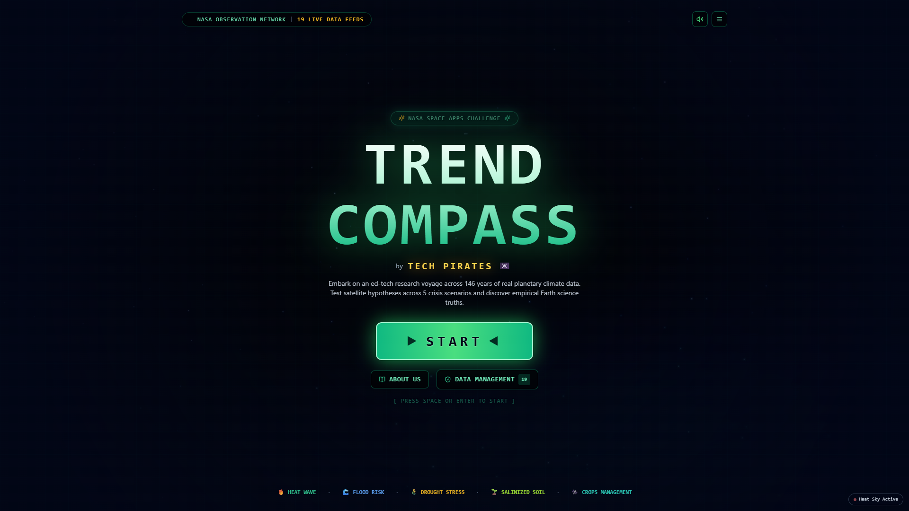
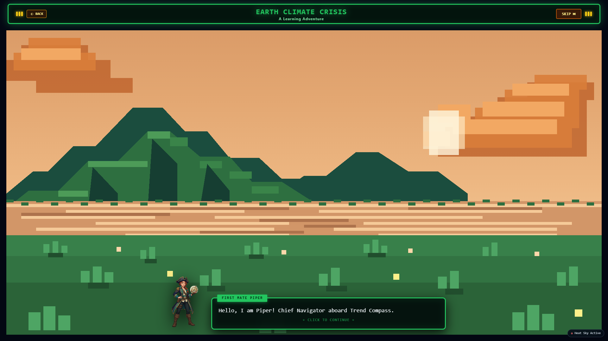
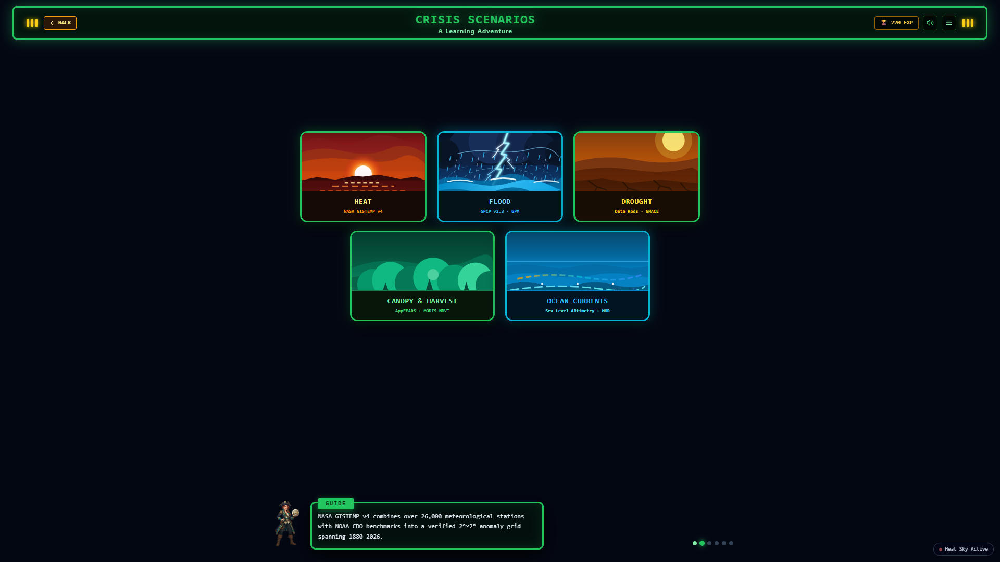
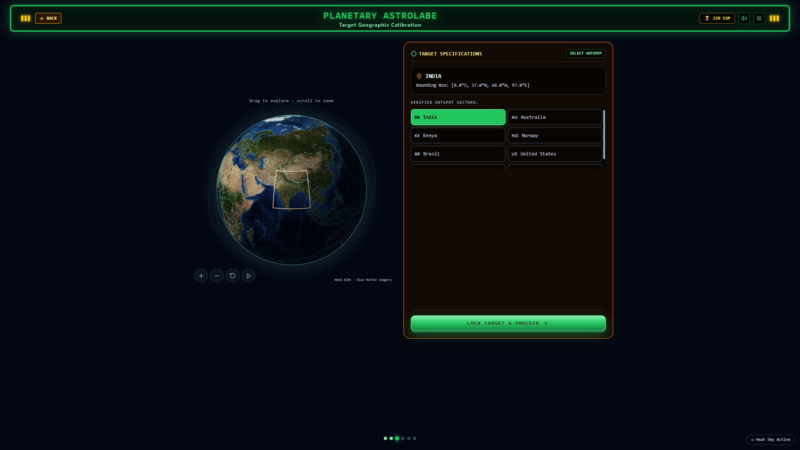
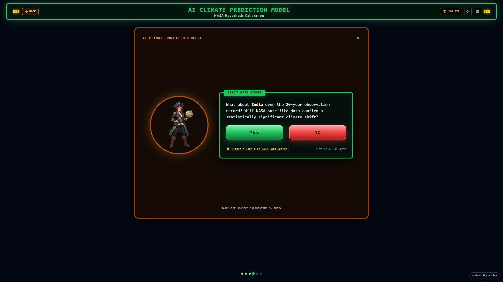
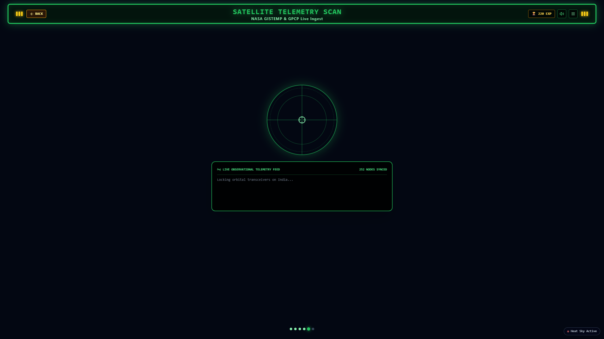
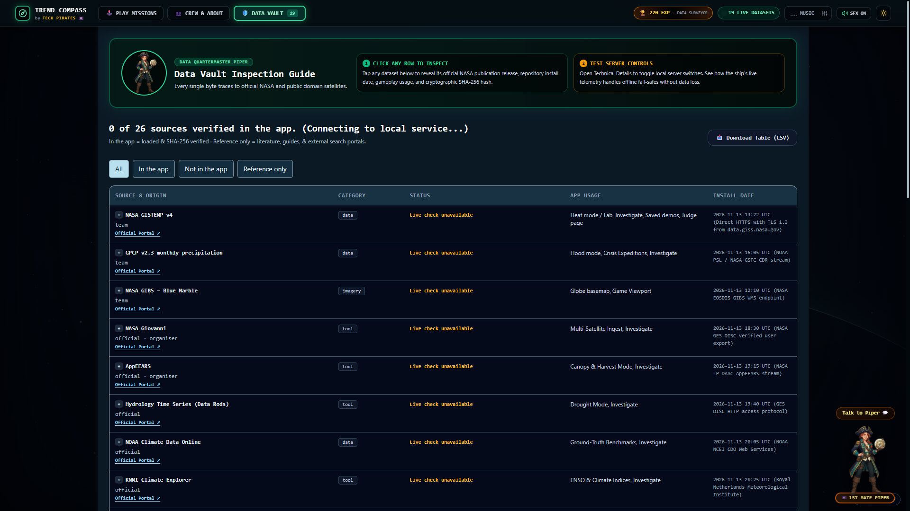
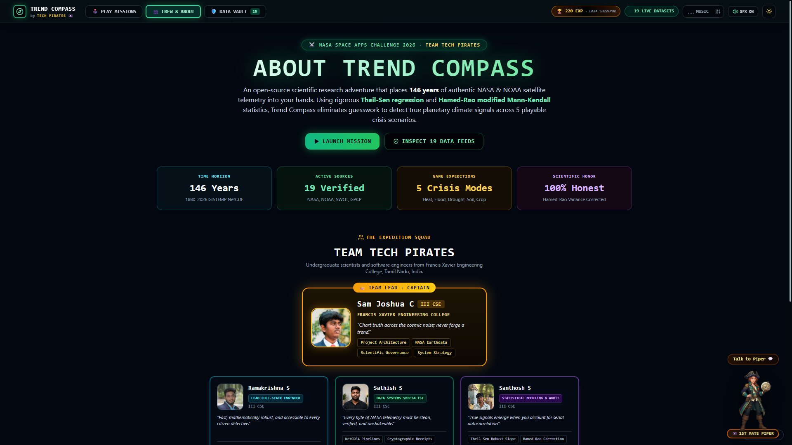

# 🧭 Trend Compass · Star Galleon (v2)

> **Turn a hunch about Earth into an evidence-based space-pirate science adventure.**  
> Built by **Tech Pirates** for the **NASA Space Apps Challenge 2026** · *“Be An Earth System Trend Detective!”*

[](https://trendcompass-techpirates.vercel.app)
[](https://www.spaceappschallenge.org/2026/challenges/be-an-earth-system-trend-detective/)
[](https://trendcompass-techpirates.vercel.app)
[](https://trendcompass-techpirates.vercel.app)
[](https://www.python.org/)
[](LICENSE)

---

## 🚀 Live Production Deployment

Trend Compass is fully deployed and accessible worldwide:
- **🌐 Web Application:** [https://trendcompass-techpirates.vercel.app](https://trendcompass-techpirates.vercel.app)
- **⚡ Frontend Infrastructure:** Hosted on **Vercel** with Next.js 14 App Router and high-speed edge distribution.
- **🛠️ Backend Services:** High-performance Python FastAPI climatological reduction and statistics engine hosted on **Render**.
- **📦 Source Repository:** [https://github.com/samjoshua7/trend-compass](https://github.com/samjoshua7/trend-compass)

---

## 🌟 Executive Summary

Discerning genuine long-term climate signals from natural, short-term oscillations is one of the grand challenges of modern Earth science. Many climate dashboards either overwhelm citizen detectives with black-box graphs or apply naive linear regressions (Ordinary Least Squares) that falsely declare short-term autocorrelation as significant trends.

**Trend Compass (v2)** transforms rigorous climatological time-series analysis into an immersive, gamified learning adventure aboard the **Star Galleon**. Guided by **First Mate Piper**, players investigate 146 years of official NASA observations, formulate scientific hypotheses, sweep planetary sensors across an interactive 3D Earth, and evaluate real trends against the challenge's **4 Core Questions**:

| Core Challenge Question | How Trend Compass Delivers Truth |
| :--- | :--- |
| **1. WHAT changed?** | Surface Temperature Anomaly relative to the 1951–1980 baseline (NASA GISTEMP v4) or Precipitation Rates (GPCP v2.3 CDR). |
| **2. WHERE?** | User-selected geographic bounding box across an interactive 3D WebGL Earth globe with cosine-latitude cell weighting. |
| **3. HOW MUCH?** | Non-parametric **Theil–Sen robust median slope** per decade with 95% rank confidence intervals. |
| **4. IS IT SIGNIFICANT?** | **Hamed–Rao Modified Mann-Kendall test**, adjusting variance for geophysical serial autocorrelation ($p$-value at $\alpha = 0.05$). |

> 💡 **Core Scientific Philosophy:** A prediction can be wrong and still lead to a breakthrough discovery. **A non-statistically significant result does NOT mean nothing changed**—it means the signal is currently within the envelope of natural climatic variability.

---

## 📸 Product Walkthrough & Live v2 Visual Evidence

All captures below are taken directly from the **v2 production release**:

### 1. Spaceship Observation Bridge & Piper Briefing (v2)
*First Mate Piper welcomes the crew aboard the Star Galleon, introducing the planetary detective assignment with typewriter speech and audio chimes.*


---

### 2. Planetary Crisis Expeditions Selection (v2)
*Choose your scientific campaign across active planetary crisis horizons (Heat GISTEMP v4, Flood GPCP v2.3, Drought SMAP, Biosphere MODIS, Ocean MUR SST).*


---

### 3. Planetary Navigation & 3D Globe Targeting (v2)
*Explore regions on an interactive 3D NASA Blue Marble globe with click-to-rotate controls, custom coordinate bounding boxes, and hotspot presets.*


---

### 4. Tactile Detective Prediction Challenge (v2)
*Before the data is revealed, players commit to an honest scientific prediction: **Rising (+🌡️)**, **Falling (-❄️)**, **No Significant Trend (⚖️)**, or **Unsure (❓)**—respecting uncertainty as valid science.*


---

### 5. 360° NASA Sensor Sweep & Radar Telemetry Scan (v2)
*Full-screen rotating 360° radar sweep, Ku-band/IR oscilloscope frequency visualizer, real-time telemetry stream, and live memory-mapped query to the FastAPI backend.*


---

### 6. Celebratory Discovery Deck & The 4 Answers (v2)
*Piper celebrates the completed scan, presenting the 4 core answers as holographic HUD cards alongside earned detective badges and voyage logbook EXP.*


---

### 7. Transparent Data Vault & Provenance Controls (v2)
*Manage and audit 19 scientific telemetry datasets, complete with cryptographic SHA-256 receipts, official NASA/NOAA citations, and local kill switches.*


---

### 8. The Expedition Squad & Crew Roster (v2)
*Meet Team Tech Pirates from Francis Xavier Engineering College on the integrated About Us deck.*


---

## 👥 Team Tech Pirates & Core Contributions

**Institution:** Francis Xavier Engineering College (FXEC), Tirunelveli, Tamil Nadu, India  
**Challenge:** NASA Space Apps Challenge 2026 — *Be An Earth System Trend Detective!*

<table align="center">
  <tr>
    <td align="center" width="33%">
      <br/>
      <b>Sam Joshua C</b><br/>
      <sub><b>Team Lead · Captain</b></sub><br/>
      <sub>III CSE · FXEC</sub><br/>
      <a href="https://github.com/samjoshua7"><code>@samjoshua7</code></a><br/>
      <sub><a href="mailto:samjoshua.paldwin@gmail.com">samjoshua.paldwin@gmail.com</a></sub>
    </td>
    <td align="center" width="33%">
      <br/>
      <b>Ramakrishna S</b><br/>
      <sub><b>Lead Full-Stack Engineer</b></sub><br/>
      <sub>III CSE · FXEC</sub><br/>
      <a href="https://github.com/nijesh7"><code>@nijesh7</code></a><br/>
      <sub><a href="mailto:nijeshsrk@gmail.com">nijeshsrk@gmail.com</a></sub>
    </td>
    <td align="center" width="33%">
      <br/>
      <b>Sathish S</b><br/>
      <sub><b>Data Systems Specialist</b></sub><br/>
      <sub>III CSE · FXEC</sub><br/>
      <sub><code>Data Pipeline &amp; Ingest</code></sub><br/>
      <sub><a href="mailto:sathish@fxec.ac.in">sathish@fxec.ac.in</a></sub>
    </td>
  </tr>
  <tr>
    <td align="center" width="33%">
      <br/>
      <b>Santhosh S</b><br/>
      <sub><b>Statistical Modeling &amp; Audit</b></sub><br/>
      <sub>III CSE · FXEC</sub><br/>
      <sub><code>Stats &amp; Verification</code></sub><br/>
      <sub><a href="mailto:santhosh@fxec.ac.in">santhosh@fxec.ac.in</a></sub>
    </td>
    <td align="center" width="33%">
      <br/>
      <b>SAM BRAINARD M</b><br/>
      <sub><b>Cartography &amp; GIS Officer</b></sub><br/>
      <sub>II ECE · FXEC</sub><br/>
      <sub><code>Spherical Projections &amp; GIS</code></sub><br/>
      <sub><a href="mailto:sambrainard@fxec.ac.in">sambrainard@fxec.ac.in</a></sub>
    </td>
    <td align="center" width="33%">
      <br/>
      <b>Rafin Antony A</b><br/>
      <sub><b>Satellite Telemetry Specialist</b></sub><br/>
      <sub>II ECE · FXEC</sub><br/>
      <sub><code>Sensor Integration &amp; Feeds</code></sub><br/>
      <sub><a href="mailto:rafinantony@fxec.ac.in">rafinantony@fxec.ac.in</a></sub>
    </td>
  </tr>
</table>

### Detailed Contribution Matrix

| Team Member | Domain & Role | Key Contributions |
| :--- | :--- | :--- |
| **Sam Joshua C** | Project Leadership & Science Architecture | Overall project architecture, NASA Earthdata acquisition, statistical methodology governance (Hamed-Rao & Theil-Sen), UI art direction, Vercel/Render deployment architecture, and challenge compliance. |
| **Ramakrishna S** (`@nijesh7`) | Lead Full-Stack & Systems Engineering | Built the 114 MB memory-mapped NetCDF pipeline, FastAPI backend services, Next.js 14 interactive UI, 3D WebGL globe integration, automated validation suite, and cross-platform API wiring. |
| **Sathish S** | Data Systems & Infrastructure | NetCDF4 decompression algorithms, chunk loader optimization, cryptographic SHA-256 receipts, cold-start caching, and spatial indexing. |
| **Santhosh S** | Climatological Statistics & Audit | Theil–Sen robust slope estimation, Hamed–Rao Modified Mann-Kendall variance correction, p-value validation, and independent test harness. |
| **SAM BRAINARD M** | GIS & Orbital Cartography | Spherical coordinate projections, antimeridian bounding box transformations, NASA GIBS Blue Marble layer integration, and GIS math. |
| **Rafin Antony A** | Satellite Telemetry & Remote Sensing | Remote sensing telemetry feeds (MODIS, GPCP, SWOT, RADARSAT), spectral radiance mapping, and sensor latency verification. |

---

## 🔬 Mathematical & Statistical Methodology

Standard linear regression (OLS) is fundamentally flawed for climate data because climatic time-series exhibit **serial autocorrelation** (e.g., strong multi-year El Niño or Atlantic Multidecadal trends). Autocorrelation inflates the test statistic, leading to false declarations of statistically significant trends.

Trend Compass solves this with a two-tier non-parametric approach:

### 1. Robust Trend Magnitude (Theil–Sen Estimator)
The trend slope is calculated as the median of all pairwise slopes across $n$ time steps:
$$\beta = \text{Median} \left\{ \frac{x_j - x_i}{j - i} \;\middle|\; 1 \le i < j \le n \right\}$$
- **Breakdown point of 29.3%**: Unaffected by extreme seasonal outliers, volcanic spikes, or measurement drops.
- **Reporting**: Converted to decadal rates ($^\circ\text{C}/\text{decade}$ or $\text{mm}/\text{day}/\text{decade}$).

### 2. Autocorrelation-Corrected Significance (Hamed–Rao Modified Mann-Kendall)
To test $H_0: \text{no trend}$ vs $H_1: \text{monotonic trend}$, we calculate the Mann-Kendall test statistic $S$:
$$S = \sum_{i=1}^{n-1} \sum_{j=i+1}^n \text{sgn}(x_j - x_i)$$

Under geophysical serial dependence, the variance of $S$ is adjusted by variance inflation factor $\eta$:
$$\text{Var}^*(S) = \text{Var}(S) \cdot \left[ 1 + \frac{2}{n(n-1)(n-2)} \sum_{k=1}^{n-1} (n-k)(n-k-1)(n-k-2) \rho_S(k) \right]$$
where $\rho_S(k)$ represents the lag-$k$ autocorrelation coefficients of the detrended ranks. The standardized test statistic $Z$ yields the exact two-tailed $p$-value at $\alpha = 0.05$.

---

## 📡 NASA Earth Observations & Data Provenance

All observations are retrieved from official NASA and NOAA archives with immutable cryptographic receipts:

| Dataset | Origin / Provider | Coverage | Resolution | Cryptographic Receipt (SHA-256) |
| :--- | :--- | :--- | :--- | :--- |
| **NASA GISTEMP v4** | NASA GISS | 1880–2026 (1,762 mo) | 2° × 2° Grid (1200 km) | `f7788db9044d0f0e3f9561ad5d0fd82e59cdfdb82ea8a10244f78f2cb032a3c7` |
| **GISTEMP Global CSV** | NASA GISS | 1880–2026 | Global Spatial Mean | `a7b1939db2e7e484c798e925e0f07f8184356c52ac0e7ce264adcd0f25e81253` |
| **GPCP v2.3 CDR** | NASA / NOAA | 1979–2026 (574 mo) | 2.5° × 2.5° Grid | `58adbb500c5ee96590bc66f5c8ec23992451c7aa7c191834927b233a7ad6498a` |
| **GIBS Blue Marble** | NASA ESDIS / GIBS | Static | 8K Shaded Relief | `0efc32f0d1a0bcf9b68196f11a0ebb0da6e1d6f0aa1ef48fb7b32da7d8d1f550` |

*Full 19-dataset active inventory and telemetry controls can be inspected live on `/data`.*

---

## 🏗️ System Architecture

```text
                                  +---------------------------------------+
                                  |         Citizen Detective / UI        |
                                  | (Interactive Globe + Piper Companion) |
                                  +-------------------+-------------------+
                                                      |
                                                      v
                                  +---------------------------------------+
                                  |         Next.js 14 App Router         |
                                  |        (Deployed on Vercel)           |
                                  +-------------------+-------------------+
                                                      |
                                              HTTP /api/py/*
                                                      |
                                                      v
                                  +---------------------------------------+
                                  |            FastAPI Backend            |
                                  |        (Deployed on Render)           |
                                  +-------------------+-------------------+
                                                      |
                         +----------------------------+---------------------------+
                         |                                                        |
                         v                                                        v
      +--------------------------------------+                 +--------------------------------------+
      |      Memory-Mapped Binary Stores     |                 |       Climatological Statistics      |
      |   - GISTEMP v4 (114 MB float32)      |                 |   - Theil-Sen Robust Slope (SciPy)   |
      |   - GPCP v2.3 Precipitation (46 MB)  |                 |   - Hamed-Rao Mann-Kendall           |
      |   - Cosine-Latitude Spatial Weight   |                 |   - Confidence Intervals (95%)       |
      +--------------------------------------+                 +--------------------------------------+
```

---

## 🚀 Quick Start / Local Installation

### Prerequisites
- **Python 3.11+**
- **Node.js 20+** and `npm`
- **Git**

### 1-Click Launch (Windows)
```cmd
.\start-all.bat
```
*This starts the FastAPI backend on port 8000 and the Next.js frontend on port 3000 simultaneously.*

### Manual Step-by-Step Setup

#### 1. Backend Setup
```bash
# Clone the repository
git clone https://github.com/samjoshua7/trend-compass.git
cd trend-compass

# Create and activate virtual environment
python -m venv .venv
source .venv/bin/activate       # On Windows: .\.venv\Scripts\Activate.ps1

# Install dependencies
pip install -r api/requirements.txt

# Run backend API
$env:DATA_ADAPTER = "gistemp"   # On Linux/macOS: export DATA_ADAPTER=gistemp
uvicorn api.app.main:app --host 127.0.0.1 --port 8000 --reload
```
*API Documentation will be live at `http://127.0.0.1:8000/docs`.*

#### 2. Frontend Setup
```bash
# Open a new terminal in the repository root
cd web
npm install
npm run dev
```
*Frontend will be live at `http://localhost:3000`.*

---

## 🧪 Verification & Automated Testing

All scientific reductions, data adapters, and API endpoints are verified by an automated test suite:

```bash
# Run backend pytest suite (30 passed in < 3s)
python -m pytest api/tests -q

# Run independent NetCDF vs API mathematical audit
python tests/audit/gistemp_audit.py

# Verify Next.js frontend production compilation (19 static routes)
cd web
npm run build
```

---

## 📜 License & Acknowledgments

- **Live Production App:** [https://trendcompass-techpirates.vercel.app](https://trendcompass-techpirates.vercel.app)
- **Source Code License:** [Apache License 2.0](LICENSE).
- **Earth Science Data:** Courtesy of **NASA GISS**, **NASA ESDIS / GIBS**, and **NOAA PSL**.
- **Institution:** Francis Xavier Engineering College, Department of Computer Science & Engineering.
- **Challenge Organizers:** NASA Space Apps Challenge 2026 Global Organizing Team.
