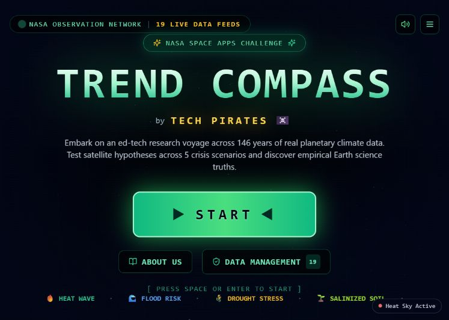
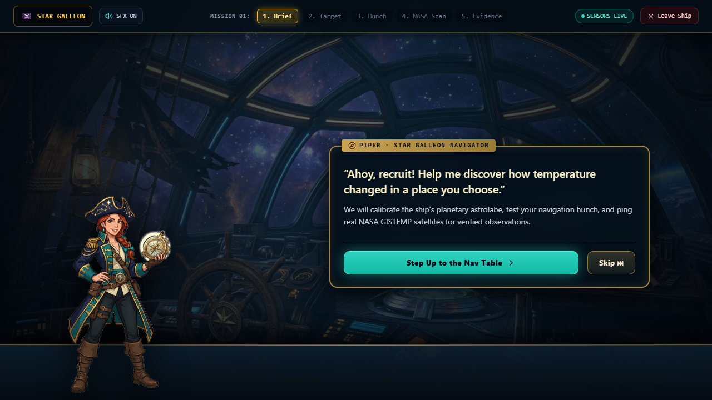
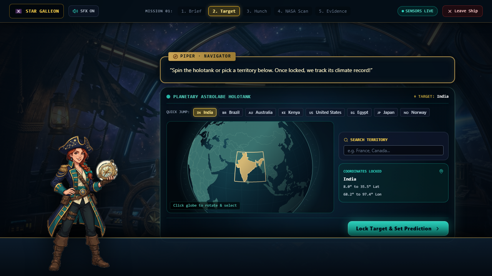
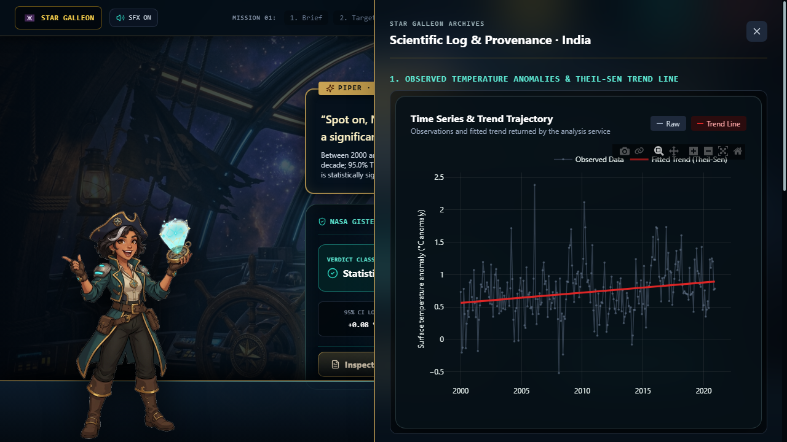
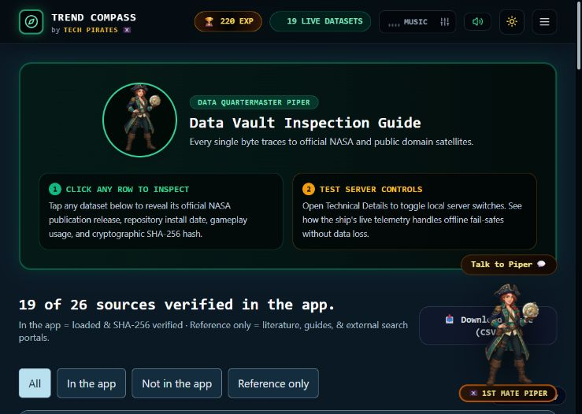

# Trend Compass · Star Galleon

**Turn a hunch about Earth into an evidence-based investigation.**

Built by **Tech Pirates** for NASA Space Apps 2026 · *Be An Earth System Trend Detective!*

[Judge's guide](#for-jurors) · [Run locally](#run-locally) · [Validation](docs/VALIDATION.md) · [Data and AI credits](docs/DATA_AND_AI.md)

## The idea

Climate charts can be difficult to interpret without statistical training. Trend Compass gives students, educators, and curious explorers a guided way to ask a question, make a prediction, and compare it with Earth observations.

Players board the Star Galleon with **First Mate Piper**, choose an expedition, select a region on an interactive globe, and investigate a trend. The discovery screen answers four questions:

| Question | Evidence the player inspects |
| --- | --- |
| **What changed?** | The measured variable and its units |
| **Where?** | Selected region and bounding coordinates |
| **How much?** | Trend rate and reported uncertainty |
| **Is it significant?** | Statistical method, p-value, and verdict |

A prediction can be wrong and still lead to a useful discovery. **A non-significant result does not establish that nothing changed.**

## For jurors

1. Open the running app at `/` and start the adventure.
2. Choose **Heat** for the clearest documented temperature-data path.
3. Select a preset region, make a prediction, and run the scan.
4. Read the four answers. Open the evidence drawer for the chart, statistical details, and provenance; try CSV export.
5. Visit `/data` for the source inventory and `/about` for the approach and crew.

The separate `/voyage` route contains the experimental **Sea of Time** sailing investigation. See [M0](docs/VOYAGE_M0.md) and [M1](docs/VOYAGE_M1.md); human playtest acceptance remains pending.

**Submission links:** [GitHub repository](https://github.com/samjoshua7/trend-compass). A production app URL and final demo-video URL have not been confirmed. [Repository setup notes](docs/REPOSITORY_DETAILS.md) identify the remaining submission steps.

This repository is a single-commit source snapshot, not a record of when development began. The [original development repository](https://github.com/samjoshua7/nasa-app) retains the project history.

## Product preview

The Home and Data Vault captures below were taken from the local app on November 16, 2026. The other game images are historical November 14 captures. Screen labels such as “19 live data feeds” are interface claims, not independent acquisition verification; see the data limitations below.

### Current home screen



### Guided adventure

Piper introduces the investigation and guides the expedition.



### Geographic exploration

Choose a region on the globe. Analysis uses bounding boxes rather than exact country polygons.



### Evidence behind the result

The scientific drawer lets players examine the reasoning behind the verdict.



### Sources and availability

The Data page brings source references, usage information, and controls together. A listed or enabled resource alone does not establish ingestion.



## What is implemented

- Guided mission, globe targeting, prediction, scanning, and discovery flow.
- Time-series charts, statistical details, provenance inspection, and CSV export.
- Piper companion, optional sound, voyage history, and browser-local player career dossier.
- FastAPI analysis over local observations, with a Next.js proxy and saved-hotspot fallback.
- Source inventory and local data controls.
- Experimental Phaser-based Sea of Time investigation and research-log features.

This is a working prototype. Measured learning outcomes and broad device/accessibility certification are not claimed.

## Data and scientific approach

| Resource | Role | Evidence and limits |
| --- | --- | --- |
| NASA GISTEMP v4 | Core temperature-anomaly analysis | Official acquisition and independent audit documented in [validation](docs/VALIDATION.md) |
| GPCP v2.3 | Precipitation analysis path | Adapter support exists; independent provenance audit remains open in [tasks](docs/TASKS.md) |
| NASA GIBS Blue Marble | Globe imagery | Visual context only; never numerical trend input |
| Other inventory resources | References, controls, or extensions | Listing does not prove an independent working data pipeline |

The temperature pipeline builds a local memory-mapped grid. Regional means use cosine-latitude weights. Methods include **Theil–Sen slope**, **Hamed–Rao modified Mann–Kendall**, and supporting OLS/Mann–Kendall results. [Pipeline documentation](data-pipeline/README.md) explains processing; [validation](docs/VALIDATION.md) records comparisons and known numerical differences.

The main game currently requests **monthly observations for January 2000–December 2020**, distinct from full dataset coverage. Read the returned receipt for actual dates, units, and methods. Animation and scan text do not prove that every named satellite or service was queried.

Interpretation limits:

- Temperature trends do not establish local causes or predict individual extreme events.
- Monthly precipitation trends are not flood forecasts or flood-extent observations.
- Coarse grids, bounding boxes, missing data, and changing coverage limit interpretation.
- Matching saved-hotspot results are precomputed, not live satellite acquisition. General analysis needs the backend and observation store.
- A checksum establishes file integrity, not scientific validity.

## Architecture

```text
Player: region + prediction
          |
Next.js game -> /api/py/* -> FastAPI -> local grids + statistics
                    |
          Matching saved-hotspot fallback
                    |
          Discovery + chart + provenance + CSV
```

Predictions belong to the game; they do not enter the numerical analysis request.

| Layer | Stack / location |
| --- | --- |
| Interface | Next.js 14, React 18, TypeScript, Tailwind · web/ |
| Game and charts | Phaser 3, Canvas/WebGL globe, Plotly |
| API and statistics | FastAPI, NumPy, SciPy, pandas, pyMannKendall, statsmodels · api/ |
| Processing | Python, xarray, NetCDF readers · data-pipeline/ |
| Evidence | tests/audit/ and docs/ |

## Run locally

Prerequisites: **Python 3.11+**, **Node.js 20**, and npm. Commands below use **PowerShell**.

### 1. Install dependencies

```powershell
git clone https://github.com/samjoshua7/trend-compass.git
cd trend-compass
python -m venv .venv
.\.venv\Scripts\Activate.ps1
python -m pip install -r api/requirements.txt
cd web
npm ci
cd ..
```

### 2. Prepare temperature observations

Raw observations and generated stores are not included in a clean source checkout. These steps require official NASA endpoint access:

```powershell
python data-pipeline/download_gistemp.py
python data-pipeline/build_gistemp.py
python data-pipeline/cache_presets.py
```

If access is blocked, follow the documented `--from-file` route in [pipeline instructions](data-pipeline/README.md). Preserve acquisition receipts. These commands prepare temperature, not every listed dataset.

### 3. Start the API

```powershell
$env:DATA_ADAPTER = 'gistemp'
python -m uvicorn api.app.main:app --host 127.0.0.1 --port 8000
```

Health: `http://127.0.0.1:8000/health` · API documentation: `http://127.0.0.1:8000/docs`.

### 4. Start the frontend in another terminal

```powershell
cd web
$env:PY_API_URL = 'http://127.0.0.1:8000'
npm run dev
```

Open **http://localhost:3000**. Once dependencies and observations are prepared, Windows users can also use `start-all.bat` to launch services. See the [deployment runbook](docs/DEPLOYMENT.md) for hosting configuration; instructions do not establish deployment health.

## Verification and remaining work

```powershell
# Root, Python environment active
python -m pytest
python tests/audit/gistemp_audit.py

# Frontend
cd web
npx tsc --noEmit
npm run lint
npm run build
```

Snapshot verification results are recorded in [backend test output](docs/logs/submission-pytest.txt), [frontend build output](docs/logs/submission-build.txt), and [STATUS](docs/STATUS.md). Earlier evidence and remaining work are in [TASKS](docs/TASKS.md) and [VALIDATION](docs/VALIDATION.md). The November 16 browser check loaded Home and Data Vault; it did not verify a complete mission playthrough.

Before submission: capture the current desktop/phone flow, finish human playtests, audit precipitation provenance, reconcile inventory and scan-text claims with acquisition receipts, and verify public app/repository/video access while signed out.

## Credits and license

Created by **Tech Pirates**. See [Data and AI credits](docs/DATA_AND_AI.md) and the [AI activity log](docs/AI_LOG.md) for datasets, imagery, dependencies, and assistance.

OpenAI Codex and Antigravity assisted development, audits, assets, and documentation. Piper includes AI-generated artwork. Generative AI is not the source of observed temperature values. Experimental voyage teaching aids include explicitly labelled simulations, described in the credits.

The repository [LICENSE](LICENSE) contains **Apache License 2.0**. Data and dependencies retain their applicable terms; review dependency licensing separately. This independent challenge submission does not claim NASA endorsement.
