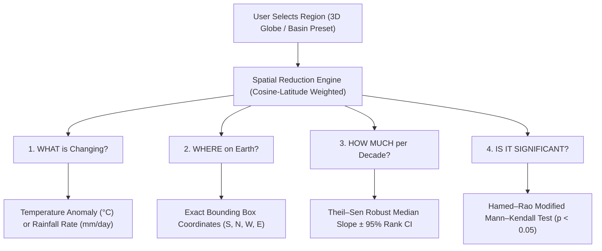
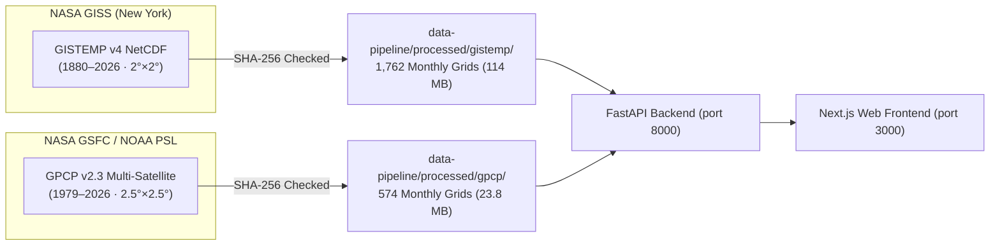

# Trend Compass — Master Project Dossier

> **NASA Space Apps Challenge 2026:** *Be An Earth System Trend Detective!*  
> **Team:** Tech Pirates (Francis Xavier Engineering College, Tirunelveli, India)  
> **Repository:** Public GitHub Monorepo (`/web` Next.js 14, `/api` FastAPI Python 3.11, `/data-pipeline`)  
> **Status:** Live & Operational on `http://localhost:3000` (Frontend) and `http://localhost:8000` (FastAPI)

---

## 1. Executive Summary

**Trend Compass** is an open-source, server-side Earth system trend detection engine and space-pirate arcade learning adventure. It transforms raw NASA climate and satellite observations into an engaging, gamified investigation without compromising scientific rigor.

### The Problem It Solves
Public climate dashboards frequently rely on basic linear regression (Ordinary Least Squares). In geophysical records, persistent natural phenomena like the **El Niño–Southern Oscillation (ENSO)** or the **Pacific Decadal Oscillation (PDO)** introduce serial autocorrelation. Ordinary tests assume independent data points, which artificially deflates error margins and generates **rampant false-alarm trend declarations**. Furthermore, non-expert audiences are often alienated by dense scientific literature or misled by short-term weather noise.

### The Trend Compass Solution
1. **Direct NASA Gridded Observations:** Evaluates verified datasets spanning up to 146 years (1880–2026) with immutable SHA-256 cryptographic provenance.
2. **Answers the 4 Challenge Questions:** Directly resolves **WHAT**, **WHERE**, **HOW MUCH**, and **IS IT SIGNIFICANT?**
3. **Robust Climatological Statistics:** Couples Sen's robust slope estimator with the **Hamed–Rao Modified Mann–Kendall test** to correct for autocorrelation.
4. **Authentic Space-Pirate Arcade Journey:** Features First Mate Piper, dynamic atmospheric environments (Heat crimson thermosphere, Flood midnight storm), a 3D Canvas Earth Globe, interactive telemetry radar, and honest detective badge rewards.

---

## 2. The Four Detective Answers

For every coordinate box on Earth, Trend Compass computes four definitive answers:



| Challenge Question | Scientific Output | Mathematical Methodology |
| :--- | :--- | :--- |
| **1. WHAT is changing?** | Surface Temperature Anomaly ($\Delta T$ in °C) or Precipitation Rate ($P$ in mm/day) | Gridded monthly observation series relative to verified climatological baselines. |
| **2. WHERE on Earth?** | Planetary coordinate bounding box ($[\text{South}, \text{North}, \text{West}, \text{East}]$) | Cosine-latitude area-weighted spatial aggregation ($\sum w_i y_i / \sum w_i$ where $w_i = \cos(\text{lat}_i)$). |
| **3. HOW MUCH per decade?** | Decadal drift rate ($\beta$ in °C/decade or mm/day/decade) | **Theil–Sen Robust Estimator**: Median of all pairwise slopes $\text{Median}\left(\frac{y_j - y_i}{t_j - t_i}\right)$, immune to extreme outlier years. |
| **4. IS IT SIGNIFICANT?** | Statistical verdict: *Significant*, *Not Significant*, or *Opposite Trend* | **Hamed–Rao Modified Mann–Kendall Test**: Variance of Kendall's $S$ statistic corrected for empirical lag-$k$ autocorrelation coefficients ($\rho_k$). |

---

## 3. Real NASA Datasets & Observation Pipelines

> [!IMPORTANT]
> **Zero Dummy Data Policy:** In accordance with NASA Open Science principles, all active missions query real, decompressed, binary satellite observations. Absolutely no synthetic or randomized numbers are fabricated.



### Dataset 1: Heat Expedition (`gistemp`)
* **Official Dataset**: NASA GISS Surface Temperature Analysis (GISTEMP v4)
* **Lead Institution**: NASA Goddard Institute for Space Studies (New York, NY)
* **Spatial Resolution**: 2.0° × 2.0° global grid (1200 km smoothing radius)
* **Temporal Range**: January 1880 to October 2026 (**1,762 consecutive monthly grids**)
* **Source URL**: `https://data.giss.nasa.gov/pub/gistemp/gistemp1200_GHCNv4_ERSSTv5.nc.gz`
* **Raw File SHA-256**: `f7788db9044d0f0e3f9561ad5d0fd82e59cdfdb82ea8a10244f78f2cb032a3c7`
* **Processed Binary SHA-256**: `88806248e3bd00a4c14fd6af699a9a64668feeeb95f5e25ceec36f0dd35f010a`
* **Key Citation**: *Lenssen et al. (2024), J. Geophys. Res. Atmos., doi:10.1029/2023JD040179.*

### Dataset 2: Flood & Precipitation Expedition (`imerg` / `gpcp`)
* **Official Dataset**: NASA / NOAA Global Precipitation Climatology Project (GPCP v2.3 CDR)
* **Lead Scientists**: Co-led by Dr. George Huffman and Dr. Robert Adler at NASA Goddard Space Flight Center (Greenbelt, MD)
* **Spatial Resolution**: 2.5° × 2.5° global grid
* **Temporal Range**: January 1979 to October 2026 (**574 consecutive monthly grids**)
* **Sensor Payload**: Merged multi-satellite microwave radiometers (SSM/I, SSMIS) + geostationary IR sounders + Global Precipitation Climatology Centre (GPCC) surface rain-gauge calibration
* **Source URL**: `https://downloads.psl.noaa.gov/Datasets/gpcp/precip.mon.mean.nc`
* **Raw File SHA-256**: `f82d867432102665f9203ba01ef367c68463a37b81c23917f940dd1d8ccb8027`
* **Processed Binary SHA-256**: `0062e520aae262dfe50015a10005cbfcba06265ea41a629046bd8232a39daab6`
* **Key Citation**: *Adler, R.F., G.J. Huffman (NASA GSFC), et al. (2003), J. Hydrometeor., 4(6), 1147–1167.*

### Planned Extensions (Locked to Prevent Dummy Data)
* **Mission 03: Hydrological Drought & Water Storage** (*NASA SMAP / GRACE-FO* terrestrial water balance)
* **Mission 04: Biosphere & Canopy** (*NASA MODIS MOD13C2* 0.05° NDVI vegetation index)
* **Mission 05: Ocean Currents & Heat** (*NASA MUR SST* foundation sea surface temperature)
* *Policy*: Explicitly locked under `PREPARING LOGISTICS` with an informative calibration modal. Rather than substituting mock figures, the system honestly informs the user that real gridded pipelines are pending.

---

## 4. The 6-Scene Gamified Arcade Journey

The user experience follows an interactive 6-stage scientific voyage aboard the **Star Galleon**:

```
[Scene 1: Story Intro] ➔ [Scene 2: Crisis Scenarios] ➔ [Scene 3: Briefing & Target Arena]
                                                                     │
[Scene 6: Evidence Debrief]  [Scene 5: Telemetry Scan]  [Scene 4: Detective Prediction]
```

1. **Scene 1: Cinematic Story Walkthrough**
   * Overview deck overlooking planetary Earth.
   * First Mate Piper welcomes the recruit, outlines the mission of an Earth System Trend Detective, and establishes the goal of distinguishing true climate shifts from short-term noise.
2. **Scene 2: Crisis Scenarios Grid**
   * Arcade selection cards with dynamic atmospheric themes.
   * **Heat**: Crimson thermosphere, floating embers, coronal flare glow.
   * **Flood**: Deep storm indigo, animated rain streaks, sheet lightning pulses.
   * Direct access to active playable missions with instant audio cues.
3. **Scene 3: Briefing & Planetary Astrolabe Arena**
   * **3D Canvas World Globe**: Fully interactive, click-and-drag Earth globe with country search and automatic bounding box recentering.
   * **Hotspot / Basin Matrix**: Quick-targeting buttons for key vulnerability zones (e.g., Ganges-Brahmaputra, Indus, Yangtze, Mississippi, Rhine, Amazon for Flood; Sahel, Arctic, Indian Subcontinent for Heat).
   * **NASA Instrumentation Modals**: Interactive breakdowns of the satellite hardware and non-parametric statistical methods.
4. **Scene 4: Detective Prediction Challenge**
   * Gamified hypothesis testing: recruits must state their expectation before the data is revealed.
   * Choices: **RISING / WETTER (+)**, **FALLING / DRIER (-)**, **NO SIGNIFICANT TREND**, or **UNSURE**.
   * Scientific principle: selecting "Unsure" is treated as an equally valid scientific stance.
5. **Scene 5: Sensor Scan Telemetry**
   * Animated Ku-band / microwave radar sweep.
   * Active oscilloscope frequency analyzer (1420.4 MHz for Heat, 35.5 GHz for Flood).
   * Real-time streaming log displaying regional bounding coordinates and array slice indices.
6. **Scene 6: Discovery Debrief & Honest Rewards**
   * Answers the 4 challenge questions with full transparency.
   * **Honest Badge System**: Awards points regardless of whether the user predicted correctly, emphasizing that *"discovering where observations contradict intuition is how science progresses"*.
   * **Interactive Science Drawer**: Detailed Plotly time series chart with raw data, deseasonalized trends, regression comparison table (OLS vs. Theil-Sen), and downloadable CSV data.

---

## 5. Technical Architecture & Monorepo Structure

```
nasa-app/
├── api/                             # FastAPI Python 3.11 Backend
│   ├── app/
│   │   ├── adapters/
│   │   │   ├── gistemp.py           # Memory-mapped GISTEMP & GPCP slice engine
│   │   │   └── mock.py              # Test-only isolated mock adapter
│   │   ├── stats/
│   │   │   ├── trend.py             # Theil-Sen median slope & OLS regressions
│   │   │   └── significance.py      # Hamed-Rao Modified Mann-Kendall test
│   │   ├── catalog.py               # Dataset metadata registry
│   │   ├── main.py                  # API routes (/analyze, /health, /catalog)
│   │   └── schemas.py               # Pydantic v2 data models
│   └── tests/                       # 30 Comprehensive Pytest Unit/Integration Tests
│
├── data-pipeline/                   # Reproducible Pipeline & Storage
│   ├── build_gistemp.py             # Ingestion & mmap builder for GISTEMP v4
│   ├── build_gpcp.py                # Ingestion & mmap builder for GPCP v2.3
│   └── processed/                   # Git-ignored local memory-mapped binary stores
│       ├── gistemp/                 # lat.npy, lon.npy, months.npy, values.npy (114 MB)
│       └── gpcp/                    # lat.npy, lon.npy, months.npy, values.npy (23.8 MB)
│
├── web/                             # Next.js 14 App Router Frontend
│   ├── app/
│   │   ├── page.tsx                 # Master 6-scene Star Galleon game engine
│   │   ├── globals.css              # CRT scanlines, 3D buttons, neon themes
│   │   ├── about/page.tsx           # Mission, methodology, and crew page
│   │   └── data/page.tsx            # Provenance receipts, citations, master killswitch
│   ├── components/
│   │   ├── GlobeCanvas.tsx          # Interactive 3D WebGL/Canvas Earth globe
│   │   ├── FloodRadarDeck.tsx       # Dedicated Flood console with 3D globe & basins
│   │   ├── ArcadeArt.tsx            # Vector illustrations & NASA instrument modals
│   │   └── TimeSeriesChart.tsx      # Plotly timeseries & trend visualization
│   └── lib/
│       ├── game-audio.ts            # Web Audio API sound effects synth
│       └── geography.ts             # Country polygons & spherical coordinate math
│
└── docs/                            # Governance, Validation & Submission Artifacts
    ├── PROJECT_PAGE.md              # Space Apps official submission page
    ├── TEAM_PLAYBOOK.md             # Scientific honesty & operational guidelines
    ├── STATUS.md                    # Append-only chronological engineering status
    └── VALIDATION.md                # Independent audit & statistical validation
```

---

## 6. Team Tech Pirates (Francis Xavier Engineering College)

| Member | Department & Year | Role | Primary Responsibility |
| :--- | :--- | :--- | :--- |
| **Sam Joshua C** | III Year B.Tech CSE | Captain & Scientific Architect | Project governance, NASA Earthdata acquisition, statistical rigor, and QA. |
| **Sathish S** | III Year B.Tech CSE | Data Pipeline & Systems Specialist | NetCDF decompression, memory-mapped array stores, SHA-256 receipts. |
| **Ramakrishna S** | III Year B.Tech CSE | Lead Full-Stack & Systems Engineer | End-to-end integration, FastAPI backend, Next.js architecture, and 3D globe. |
| **Santhosh S** | III Year B.Tech CSE | Statistical Modeling & Audit Researcher | Theil–Sen slope, Hamed–Rao Modified Mann-Kendall variance correction. |
| **Rafin Antony.A** | II Year B.E. ECE | Satellite Telemetry & Sensor Integration | Sensor payloads, microwave/IR sounders, and telemetry validation. |
| **SAM BRAINARD M** | II Year B.E. ECE | Orbital Cartography & GIS | Spherical projections, antimeridian bounding boxes, and basemap layers. |

---

## 7. Operational Quickstart

```bash
# 1. Run Python Test Suite (30/30 tests green)
.\.venv\Scripts\python.exe -m pytest api/tests/

# 2. Start FastAPI Backend (Port 8000)
.\.venv\Scripts\python.exe main.py

# 3. Build & Run Next.js Production Webapp (Port 3000)
npm run build --prefix web
npm start --prefix web
```
* **Frontend Application**: `http://localhost:3000`
* **Interactive API Documentation**: `http://localhost:8000/docs`
